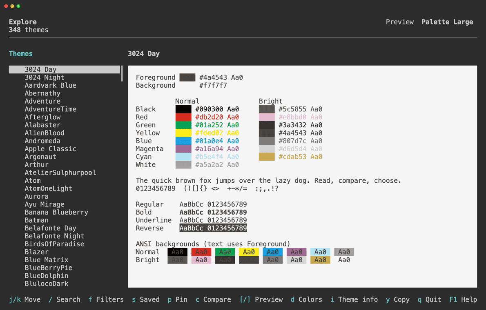

# Asinus

[](https://crates.io/crates/asinus)
[](https://ratatui.rs)

Terminal Color Theme Explorer 🫏



## About

Asinus is a TUI application for exploring, previewing, and comparing terminal color themes.

- Preview themes with built-in samples or your own text, and compare them side by side.
- Search by name, appearance, background color, brightness, and text contrast.
- Inspect color values and credits, mark favorites, and save search conditions.

## Documentation

See the [full documentation](https://lusingander.github.io/asinus/) for detailed usage, keybindings, storage locations, and terminal requirements.

## Installation

Using Cargo:

```sh
cargo install --locked asinus
```

Homebrew and pre-built binaries are also available. See [Installation](https://lusingander.github.io/asinus/getting-started.html#installation) for all options.

## Usage

Run Asinus in a True Color terminal with at least 60 columns and 22 rows:

```sh
asinus
```

Run `asinus --preview sample.txt` to preview your own text. See [Custom Samples](https://lusingander.github.io/asinus/features/explore-compare.html#custom-samples) for piped input and supported formats.

In Explore / Compare:

| Keys | Action |
| --- | --- |
| `↑` / `↓` | Select a theme |
| `/` | Search |
| `p` | Pin a theme for comparison |
| `c` | Toggle Compare |
| `F1` | Open contextual help |
| `Ctrl-C` | Quit from any screen |

See [Keybindings](https://lusingander.github.io/asinus/reference/keybindings.html) for all controls.

To customize UI colors and text styles, see [Configuration](https://lusingander.github.io/asinus/reference/configuration.html).

## License

Asinus is distributed under the [MIT License](./LICENSE).

Bundled themes come from [VHS](https://github.com/charmbracelet/vhs). Its [MIT license](./assets/vhs/LICENSE) is included in this repository.
