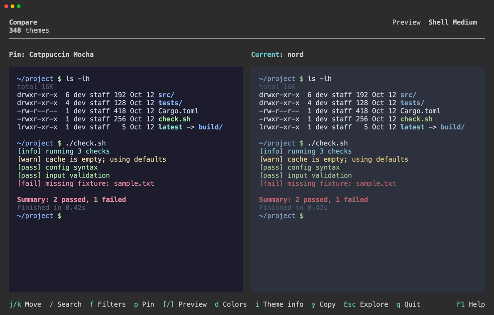

# Explore & Compare

Explore shows the selected theme, called **Current**. Pin a theme to keep it as a reference while browsing other candidates, then use Compare to view Pin and Current side by side or stacked vertically.



The pin stays available when you change search conditions. You can hide the theme list to give previews more room.

## Preview Samples

Compare shows the same portion of the selected sample for both themes. Content extending beyond the preview is clipped.

Previews show theme colors within Asinus. Use [Theme Details](theme-details.md) to inspect colors and find source links.

### Built-in Samples

| Sample | Content |
| --- | --- |
| Palette | Foreground, background, ANSI colors, and text attributes |
| Shell | A prompt, file listings, and command output |
| Git | Diffs, commits, and branches |
| Logs | Timestamps, log levels, and messages |
| TUI | Lists, tables, selections, and bars |
| Code | A Rust syntax sample |

These samples show how the theme's colors work together. Applications may use different color assignments.

The preview selector offers Auto, Small, Medium, and Large content sizes. Auto chooses a size for the available area. Fixed sizes keep the same content when resizing.

### Custom Samples

Use `-p, --preview <FILE>` to load a file as the **Custom** sample for the current run. Use `-` as the file argument to read from stdin.

```sh
asinus --preview sample.txt
git diff --color=always | asinus -p -
```

Input must be nonempty UTF-8 text, up to 1 MiB. When reading from stdin, Asinus waits for EOF before opening the TUI. The TUI requires an interactive terminal.

The preview supports ANSI colors and text attributes such as bold and underline. Color indices 0–15 use the selected theme's palette. Indices 16–255 and explicit RGB colors retain their specified values.

## Operations

In Explore / Compare:

| Keys | Action |
| --- | --- |
| `↑` / `↓` | Select the previous / next theme |
| `p` | Pin the selected theme, replace the pin, or unpin it if already pinned |
| `c` | Toggle Compare; requires a pin |
| `v` | Toggle side-by-side / stacked comparison |
| `z` | Show or hide the theme list |
| `[` / `]` | Select the previous / next preview sample |
| `P` | Open the preview selector |

In the preview selector:

| Keys | Action |
| --- | --- |
| `Tab` | Switch between Sample and Content for built-in samples |
| `←` / `→` | Change the selected value |
| `Enter` | Apply the preview settings |

See [Keybindings](../reference/keybindings.md) for all controls.
