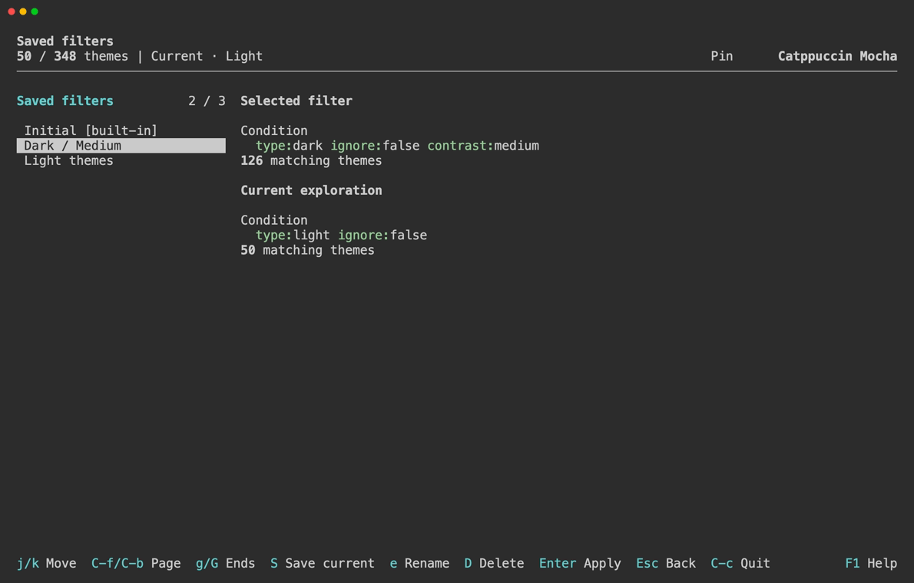

# Favorites & Saved Filters

Favorites keep promising themes easy to find. Ignored themes are hidden from the default results. A theme can be either favorite or ignored; setting one replaces the other. Pin is a separate comparison reference.

Use the Favorite and Ignored fields in [Filters](search-filters.md), or search with `favorite:true`, `ignore:all`, or `ignore:true` to revisit marked themes.

## Saved Filters

Save a set of conditions under a name to reuse it later. Saved filters store the query, so their results reflect your current favorites and ignored themes.

The built-in Initial entry restores the default conditions. Your own entries can be renamed or deleted. To replace a saved query, delete its entry and save the new conditions.

Favorites, ignored themes, and saved filters persist between runs. See [Data Files](../reference/data-files.md) for their storage locations.

## Operations

In Explore / Compare, with theme selection focused:

| Keys | Action |
| --- | --- |
| `m` | Toggle Favorite for the selected theme |
| `x` | Toggle Ignored for the selected theme |

In Explore / Compare or a detail panel:

| Keys | Action |
| --- | --- |
| `S` | Save the current conditions under a name |
| `s` | Open Saved filters |

In Saved filters:

| Keys | Action |
| --- | --- |
| `↑` / `↓` | Select an entry |
| `Enter` | Apply the selected conditions |
| `S` | Save the current exploration's conditions |
| `e` | Rename the selected entry |
| `D` | Delete the selected entry, after confirmation |

See [Keybindings](../reference/keybindings.md) for all controls.
