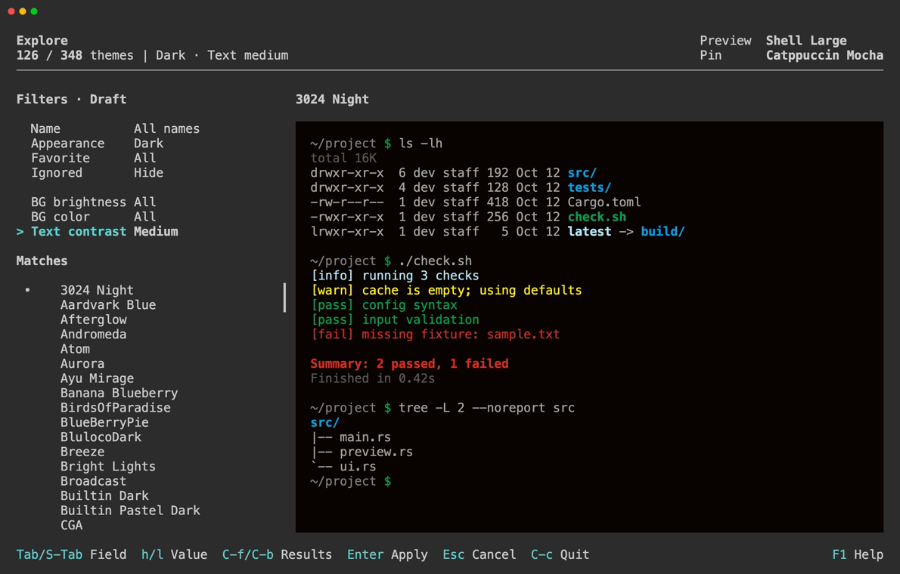

# Search & Filters

Search accepts theme names and filter expressions. Filters provides fields for the same conditions. All terms and conditions are combined with AND.



## Name Search

Name terms match substrings. Lowercase terms ignore case; a term containing an uppercase letter is case-sensitive. Multiple terms can appear in any order in the theme name.

Use double quotes to match a phrase or a literal term containing `:`. Inside quotes, use `\"` for a quote and `\\` for a backslash.

```text
catpp mocha
"Solarized Dark"
catpp type:dark bg:blue contrast:medium
```

Results stay in case-sensitive theme-name order, with no relevance ranking.

## Conditions

Filter keys and values are lowercase. Each key can appear once in a query. Omitting a key removes that restriction, except that ignored themes are hidden by default.

| Field | Search expressions | Meaning |
| --- | --- | --- |
| Appearance | `type:dark`, `type:light` | The theme's registered appearance |
| Favorite | `favorite:true`, `favorite:false` | Include only favorites, or exclude them |
| Ignored | `ignore:false`, `ignore:all`, `ignore:true` | Hide ignored themes (default), show all, or show only ignored themes |

The remaining fields classify the background and foreground colors. Appearance uses theme metadata and is independent of background brightness.

### Background Brightness

Background brightness uses OKLCH lightness, scaled to `L = 0–100`.

| Value | Search expression | Range |
| --- | --- | --- |
| Very dark | `brightness:very-dark` | `0 ≤ L < 25` |
| Dark | `brightness:dark` | `25 ≤ L < 40` |
| Medium | `brightness:medium` | `40 ≤ L < 70` |
| Light | `brightness:light` | `70 ≤ L < 95` |
| Very light | `brightness:very-light` | `95 ≤ L ≤ 100` |

### Background Color

Background color uses OKLCH chroma `C` and hue `h` in degrees. Gray includes backgrounds with a slight tint. The other groups require `C > 0.015`.

| Value | Search expression | Range |
| --- | --- | --- |
| Gray | `bg:gray` | `C ≤ 0.015` |
| Red/Pink | `bg:red-pink` | `345 ≤ h < 360` or `0 ≤ h < 40` |
| Orange/Brown | `bg:orange-brown` | `40 ≤ h < 85` |
| Yellow | `bg:yellow` | `85 ≤ h < 115` |
| Green | `bg:green` | `115 ≤ h < 170` |
| Cyan | `bg:cyan` | `170 ≤ h < 230` |
| Blue | `bg:blue` | `230 ≤ h < 285` |
| Purple | `bg:purple` | `285 ≤ h < 345` |

### Text Contrast

Text contrast uses the [WCAG contrast ratio](https://www.w3.org/TR/WCAG22/#dfn-contrast-ratio) `R` between the normal foreground and background. These groups are for exploration, not accessibility ratings or an overall readability score.

| Value | Search expression | Range |
| --- | --- | --- |
| Low | `contrast:low` | `1 ≤ R < 7` |
| Medium | `contrast:medium` | `7 ≤ R < 12` |
| High | `contrast:high` | `12 ≤ R ≤ 21` |

Background metrics are calculated from sRGB using [Oklab](https://bottosson.github.io/posts/oklab/#converting-from-linear-srgb-to-oklab). Contrast uses sRGB relative luminance. Classification uses unrounded values; [Theme info](theme-details.md#theme-info) shows the metrics for each theme.

## Operations

From Explore / Compare:

| Keys | Action |
| --- | --- |
| `/` | Open Search |
| `f` | Open Filters |
| `R` | Reset all conditions to their defaults |

While editing:

| Keys | Action |
| --- | --- |
| `↑` / `↓` | Search: select a result |
| `Tab` / `Shift-Tab` | Filters: select a field |
| `←` / `→` | Filters: change a choice |
| `Enter` | Apply the conditions |

See [Keybindings](../reference/keybindings.md) for text editing and cancellation, and [Favorites & Saved Filters](favorites-saved-filters.md) to reuse conditions.
