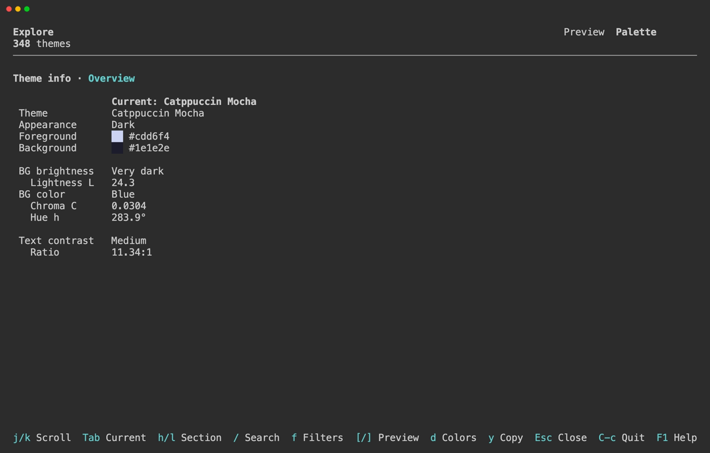
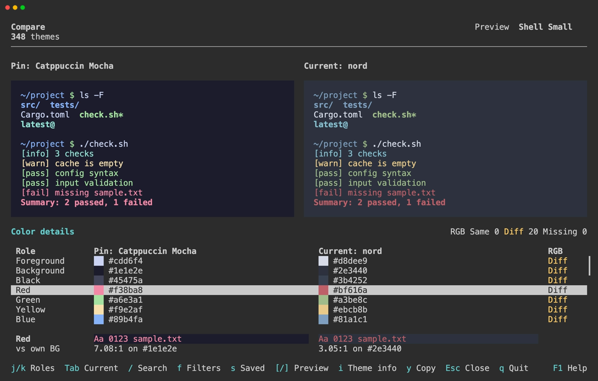

# Theme Details

Use Theme info to inspect a theme's background and source, Color details to examine individual colors, and Copy to take its name or colors to another application.

## Theme Info

Overview shows the theme name, registered appearance, foreground and background colors, background metrics, and text contrast. In Compare it shows Pin and Current together. See [Search & Filters](search-filters.md#conditions) for the metrics and classification ranges.

Credits lists the theme's supplied source links. A credit may refer to a person or another source. Select a link to open it in your default browser.

## Color Details

Color details lists foreground, background, the 16 ANSI colors, and optional cursor and selection colors, with color swatches and HEX values.

In Compare, Same and Diff indicate whether both RGB values match; Missing means at least one theme has no value for that role. Optional colors are left unspecified when absent from the theme.

Foreground and ANSI roles include a text sample on the theme's background and a contrast ratio. Background, cursor, and selection roles show their registered values without a contrast ratio. Actual cursor and selection rendering depends on your terminal.

## Copy

Choose Current or Pin and one of two formats:

| Format | Content |
| --- | --- |
| Name | The theme name |
| JSON | A color object with lowercase HEX values |

JSON contains `foreground`, `background`, `black` through `white`, `brightBlack` through `brightWhite`, and optional `cursor` and `selection` values. Unspecified colors are omitted. This is a color export, not a terminal-specific configuration file.

Copy uses the system clipboard. See [Compatibility](../reference/compatibility.md#clipboard) for required commands.

## Theme Sources

The bundled catalog comes from [VHS](https://github.com/charmbracelet/vhs). Its [MIT license](https://github.com/lusingander/asinus/blob/master/assets/vhs/LICENSE) is included with Asinus, and the supplied credits are available in Theme info.

## Operations

In Explore / Compare and detail panels:

| Keys | Action |
| --- | --- |
| `i` | Open or close Theme info |
| `d` | Open or close Color details |
| `Tab` | Switch focus between themes and the detail panel |
| `↑` / `↓` | In a detail panel: scroll the overview, select a credit, or select a color role |
| `←` / `→` | In Theme info: switch Overview / Credits |
| `t` | In a single-theme detail view: switch Current / Pin |
| `Enter` | In Credits: open the selected link |
| `y` | Open Copy |

In Copy:

| Keys | Action |
| --- | --- |
| `t` | Switch Current / Pin |
| `↑` / `↓` | Select Name / JSON |
| `Enter` | Copy the selected format |

See [Keybindings](../reference/keybindings.md) for all controls.
