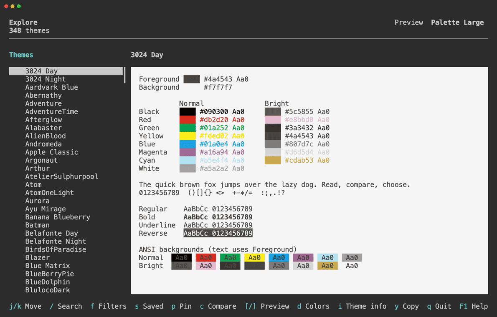

# Introduction

Asinus is a TUI application for exploring, previewing, and comparing terminal color themes.

## Key Features

- Preview themes with built-in samples or your own text, and compare them side by side.
- Search by name, appearance, background color, brightness, and text contrast.
- Inspect color values and credits, mark favorites, and save search conditions.

Themes are bundled from [VHS](https://github.com/charmbracelet/vhs), so browsing works offline.

---

Built with Rust and [Ratatui](https://ratatui.rs). Asinus is available on [GitHub](https://github.com/lusingander/asinus) under the [MIT License](https://github.com/lusingander/asinus/blob/master/LICENSE).

The bundled theme data retains [VHS's MIT license](https://github.com/lusingander/asinus/blob/master/assets/vhs/LICENSE).
